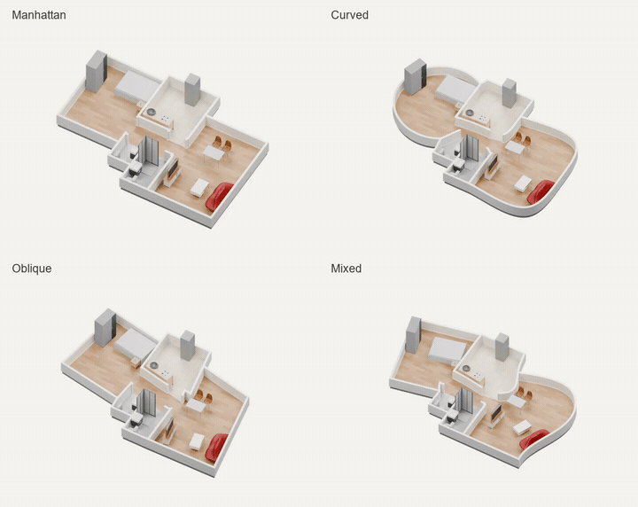
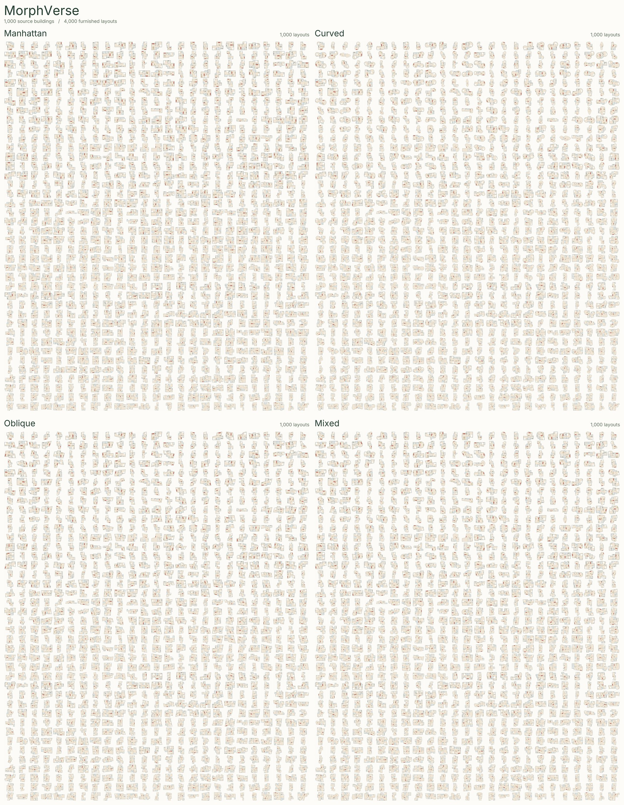

# MorphVerse

### Controllable Generation of Beyond-Manhattan Environments for Embodied AI



**1,000 source buildings · 4,000 furnished layouts · 4,000 MuJoCo scenes**

Each source building has Manhattan, curved, oblique and mixed variants with corresponding room and furniture identities. Coordinates use metres, with an XY ground plane and Z pointing up.

[中文说明](README.zh-CN.md) · [Data format](DATASET.md) · [Attribution](THIRD_PARTY.md)

## Dataset preview

[](assets/dataset-matrix-4000.jpg)

Each panel shows all 1,000 buildings. Matching cell positions correspond to the same source building across the four panels. Plans are fitted individually. [Building index](assets/dataset-matrix-index.csv)

## Download

[Download MorphVerse v1.0](https://github.com/ZhuSipu/MorphVerse/releases/download/v1.0/morphverse-v1.0.tar.xz) · [SHA-256](https://github.com/ZhuSipu/MorphVerse/releases/download/v1.0/SHA256SUMS.txt)

Extract the archive into the repository directory.

```bash
python -m tarfile -e morphverse-v1.0.tar.xz
```

## Load a scene

```bash
python -m pip install mujoco==3.3.7
```

```python
from pathlib import Path
import mujoco

path = Path("dataset/groups/10412/mixed/scene.xml").resolve()
model = mujoco.MjModel.from_xml_path(str(path))
data = mujoco.MjData(model)
mujoco.mj_forward(model, data)
mujoco.mj_step(model, data, nstep=5)
```

## Contents

The archive contains floor-plan geometry, furniture identities and poses, portable MuJoCo XML, shared furniture meshes and textures, and floor-plan previews. `dataset/catalog.csv` lists all 4,000 layouts. Scene models use relative asset paths.

The README animation uses the saved building and furniture geometry with presentation flooring, skirting, lighting and cutaway walls.

## License

Furnished scenes and visualizations use CC BY-NC 4.0. ResPlan source annotations retain CC BY 4.0. HSSD and ReplicaCAD assets retain their original CC BY-NC 4.0 terms. See [LICENSE](LICENSE) and [THIRD_PARTY.md](THIRD_PARTY.md).
