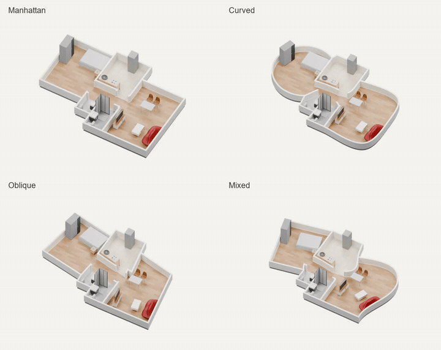
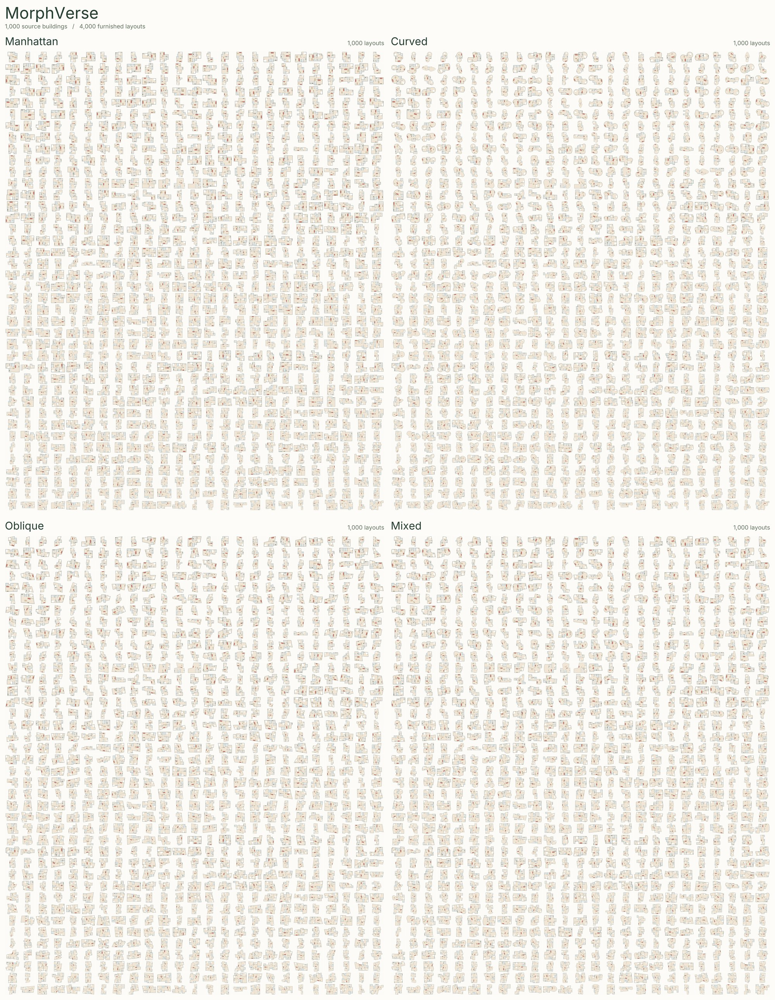

# MorphVerse 数据集



**1,000组源建筑，4,000份带家具平面及对应MuJoCo三维场景。**

每组包含曼哈顿、曲线、斜线和混合布局，共享房间与家具身份。坐标单位为米，XY为地面，Z轴向上。

[](assets/dataset-matrix-4000.jpg)

四个区块各展示1,000栋建筑，相同位置对应同一源建筑，各平面独立适配单元格。点击图片可查看高清版。[建筑位置索引](assets/dataset-matrix-index.csv)

## 下载

[下载完整数据](https://github.com/ZhuSipu/MorphVerse/releases/download/v1.0/morphverse-v1.0.tar.xz) · [SHA-256校验值](https://github.com/ZhuSipu/MorphVerse/releases/download/v1.0/SHA256SUMS.txt)

在仓库目录运行以下命令解压。

```bash
python -m tarfile -e morphverse-v1.0.tar.xz
```

每份布局包含平面几何JSON、家具对象与位姿JSON、MuJoCo XML及WebP预览。网格和纹理由全部场景共享。全量索引位于`dataset/catalog.csv`，字段见[数据格式](DATASET.md)。

安装`mujoco==3.3.7`后，可按[英文说明](README.md#load-a-scene)加载场景。场景和可视化采用CC BY-NC 4.0，ResPlan源标注沿用CC BY 4.0。第三方归属见[THIRD_PARTY.md](THIRD_PARTY.md)。
